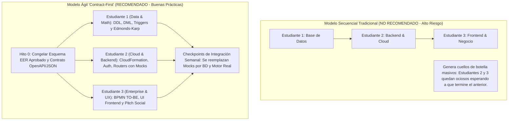
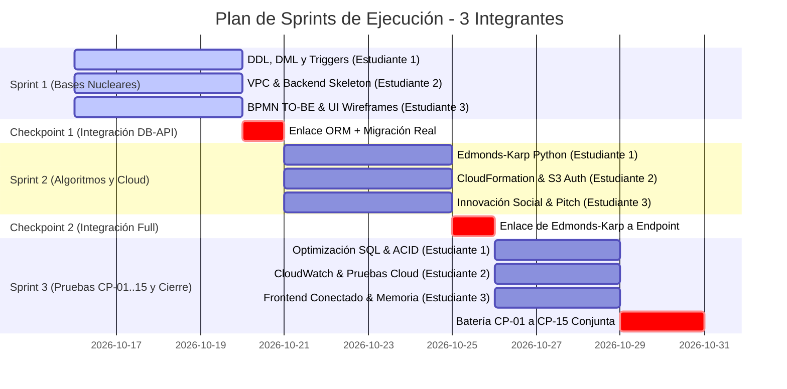

# PLAN MAESTRO DE ASIGNACIÓN, DEPENDENCIAS Y PROCESOS — ECORAEE CLOUD
**Universidad Internacional del Ecuador (UIDE) / Arizona State University (ASU)**  
**Proyecto Integrador — Quinto Semestre**

---

## 1. Estrategia de Trabajo: ¿Dependencia Secuencial o Paralelización?

En ingeniería de software existen dos formas de abordar un proyecto integrado:

### El Principio "Contract-First" (Trabajo sin bloqueos)
Para que los tres integrantes **puedan trabajar simultáneamente desde el día 1 sin depender de que el otro termine**, se aplica la técnica de **Desacoplamiento por Contratos**:
1. **Contrato de Datos (Congelado):** Ya está aprobado en el [diagrama entidad relacion actual.pdf](file:///c:/Users/airy/Downloads/Carpeta%20con%20todos%20los%20avances%20y%20contexto%20actual%20de%20proyecto/diagrama%20entidad%20relacion%20actual.pdf). El Estudiante 1 no inventará entidades sobre la marcha; todos conocen los campos exactos.
2. **Contrato de API (OpenAPI / DTOs):** Se definen los formatos JSON de entrada y salida de los endpoints (e.g., cómo luce un dispositivo, cómo se envía un lote, cómo responde el cálculo de flujo).
3. **Mocks / Stubs Temporales:** El Estudiante 3 construye la interfaz gráfica consumiendo respuestas JSON simuladas; el Estudiante 2 construye la lógica del backend simulando la base de datos con SQLite local o diccionarios; y el Estudiante 1 prueba su base de datos y algoritmo en scripts puros.
4. **Integración Fluida:** Cuando Estudiante 1 entrega el script SQL y el script Python, Estudiante 2 solo cambia la cadena de conexión y enlaza la función matemática. Cero tiempo perdido.

---

## 2. Asignación de Roles por Especialidad

La carga total del proyecto se distribuye equitativamente (~33.3% de esfuerzo real cada uno), agrupando materias afines para evitar dispersión cognitiva:

| Integrante | Rol en el Proyecto | Asignaturas Asignadas | Justificación Técnica de la Agrupación |
| :--- | :--- | :--- | :--- |
| **Estudiante 1** | **Data & Algorithm Engineer** *(Ingeniero de Datos y Algoritmos)* | • Sistemas de Gestión de Bases de Datos • Estructuras Matemáticas Discretas | La base de datos y la matemática discreta están fuertemente acopladas: las reglas lógicas proposicionales se traducen en `CHECK constraints` y triggers; las entidades `NODO_RED` y `ARISTA_RED` alimentan directamente el grafo de flujo máximo. |
| **Estudiante 2** | **Cloud & Backend Architect** *(Arquitecto Cloud y Backend)* | • Arquitectura en la Nube (AWS) • Integración Backend (FastAPI Core) | El backend en la nube requiere desplegarse en instancias EC2 dentro de una VPC privada, interactuar con S3 para evidencias y registrar métricas en CloudWatch bajo políticas IAM de mínimo privilegio. |
| **Estudiante 3** | **Enterprise, UX & Society Lead** *(Líder de Negocio, Frontend e Impacto)* | • Arquitectura Empresarial e Industrial • Innovación en la Sociedad • Frontend SPA & Memoria | La arquitectura empresarial define los flujos BPMN y reglas del negocio que guían directamente la interfaz gráfica de usuario (UX); a su vez, lidera el análisis ético de actores vulnerables y la comunicación final en inglés. |

---

## 3. Matriz Detallada de Tareas y Dependencias Estrictas

### ESTUDIANTE 1: Data & Algorithm Engineer

#### Entregables Específicos:
1. **SGBD - Modelo Lógico y DDL:** Derivar el modelo relacional en 3FN/BCNF a partir del [diagrama entidad relacion actual.pdf](file:///c:/Users/airy/Downloads/Carpeta%20con%20todos%20los%20avances%20y%20contexto%20actual%20de%20proyecto/diagrama%20entidad%20relacion%20actual.pdf) y redactar el script DDL definitivo (con índices filtrados para IMEI y claves alternas).
2. **SGBD - Datos Sintéticos (DML):** Generar dataset de prueba representativo con datos coherentes del campus UIDA (mínimo 5 centros, 20 dispositivos, 5 lotes, 10 traslados).
3. **SGBD - Lógica Programable:** Crear triggers y procedimientos almacenados para asegurar la atomicidad del inventario (`RN-06`), el historial inmutable de estados (`RN-01`) y el cierre de trazabilidad (`RN-08`).
4. **Matemática RF-MD-02:** Formalizar en documento técnico los conjuntos $A, D, C, K, S, T$, relaciones binarias (equivalencia y orden parcial) y funciones matemáticas (asignación técnica inyectiva, etc.).
5. **Matemática RF-MD-03, 04, 05:** Modelar el grafo dirigido $G=(V, E)$, implementar el algoritmo **Edmonds-Karp en Python** para Flujo Máximo y Corte Mínimo, validar con cálculo manual y comparar 2 escenarios de red.
6. **Pruebas de BD:** Ejecutar y documentar la comparativa de índices (`CP-06`) y transacciones ACID con rollback (`CP-04`, `CP-05`).

#### Dependencias:
* **Para empezar:** Solo necesita el EER aprobado (¡ya disponible!).
* **Entrega a Estudiante 2:** El script SQL limpio y la función en Python `calcular_flujo_maximo(nodos, aristas, origen, sumidero)`.

---

### ESTUDIANTE 2: Cloud & Backend Architect

#### Entregables Específicos:
1. **Cloud IaC (CloudFormation):** Plantilla reproducible que provisione: VPC con 2 subredes públicas y 2 privadas, Internet Gateway, NAT Gateway o VPC Endpoints, Security Groups cruzados y Bucket S3.
2. **Seguridad Cloud (IAM):** Implementar la matriz de 5 grupos RBAC y el Service Role `EcoRAEE-EC2-ExecutionRole` con la política adjunta `EcoRAEE-BackendAccess-Policy`.
3. **Backend API (FastAPI):**
   * Estructura modular del proyecto backend (`config/`, `models/`, `routers/`, `schemas/`, `services/`).
   * Autenticación JWT y control de acceso basado en roles (`CP-01`).
   * Endpoints de dispositivos, recepción de lotes, actualización de estado e inventario.
   * Endpoint de subida de evidencias hacia S3 mediante presigned URLs (`RN-07`).
   * Endpoint `/network/optimize` que invoca el motor de Edmonds-Karp entregado por Estudiante 1.
4. **Observabilidad:** Configuración de CloudWatch Logs, métricas operativas y alarma simulada ante fallos (`CP-13`).
5. **Estimación de Costos:** Hoja de cálculo/tabla con desglose de costos mensuales en la calculadora oficial de AWS (`RNF-08`).

#### Dependencias:
* **Para empezar en paralelo:** Construye la estructura de la API usando esquemas Pydantic basados en el EER. Simula la BD con SQLite local.
* **Dependencia de Estudiante 1:** Requiere que Estudiante 1 le entregue el archivo DDL para apuntar el ORM a la base real en RDS y el script Python de Edmonds-Karp para integrarlo al router `/network`.
* **Entrega a Estudiante 3:** Swagger / OpenAPI interactivo (`http://localhost:8000/docs`) con endpoints operativos para que el frontend se conecte.

---

### ESTUDIANTE 3: Enterprise, UX & Society Lead

#### Entregables Específicos:
1. **Arquitectura Empresarial TO-BE (Fase 2):**
   * Modelado de la Arquitectura Objetivo TO-BE en las 4 capas (Negocio, Información, Aplicaciones, Tecnología).
   * Matriz de Brechas (Gap Analysis) confrontando la línea base AS-IS (Fase 1) contra el TO-BE.
   * Modelos de procesos BPMN rediseñados (`PRC-02` a `PRC-07`).
   * Acta de Gobierno del Comité de Arquitectura (ARB - Architecture Review Board) y Hoja de Ruta (Roadmap) de implementación.
2. **Innovación en la Sociedad:**
   * Mapeo de actores vulnerables, asimetrías de poder y recolectores informales de Quito (`RF-IN-01`).
   * Análisis comparativo Top-Down vs. Bottom-Up (`RF-IN-02`).
   * Evaluación de dilemas éticos, justicia ambiental, soberanía tecnológica y privacidad (`RF-IN-03`).
   * Diseño de la intervención innovadora y socialmente responsable con KPIs cuantitativos (`RF-IN-04`).
   * Redacción del escenario futuro reflexivo y **guión + diapositivas del Pitch de 5 minutos en inglés** (`RF-IN-05`).
3. **Frontend SPA (Cliente Web):**
   * Vistas de usuario intuitivas organizadas por roles: Recepción de lotes, Registro/Consulta de QR, Diagnóstico técnico de estado y Visualizador interactivo del grafo de flujo logístico.
   * Pruebas de usabilidad e inclusión digital (`CP-15`).
4. **Consolidación de Memoria Técnica:** Orquestar el ensamble del documento final integrando los aportes de los tres compañeros.

#### Dependencias:
* **Para empezar en paralelo:** Desarrolla el TO-BE y la Innovación Social basándose en el documento AS-IS ya aprobado. Desarrolla las pantallas del frontend con datos quemados (Mocks JSON).
* **Dependencia de Estudiante 2:** Requiere que Estudiante 2 tenga levantada la API para cambiar las llamadas `fetch()` del frontend hacia los endpoints reales.

---

## 4. Matriz RACI para los 15 Casos de Prueba Oficiales (CP-01 a CP-15)

Para asegurar que ninguna prueba quede huérfana, cada uno de los 15 casos de prueba obligatorios de la rúbrica tiene un responsable principal (**Accountable/Responsible**):

| ID | Nombre de la Prueba | Responsable Principal | Soporte | Evidencia a Entregar |
| :---: | :--- | :---: | :---: | :--- |
| **CP-01** | Acceso por rol (RBAC) | **Estudiante 2** | Estudiante 3 | Capturas de acceso permitido a Técnico y denegado a Operador en endpoint seguro. |
| **CP-02** | Registro y lote único | **Estudiante 1** | Estudiante 2 | Logs de inserción en BD rechazando códigos QR o lotes duplicados. |
| **CP-03** | Transición de estado | **Estudiante 1** | Estudiante 2 | Ejecución de cambio de estado inválido rechazado por Trigger/Constraint. |
| **CP-04** | Integridad referencial | **Estudiante 1** | Estudiante 2 | Intento de eliminación en cascada bloqueado protegiendo auditoría. |
| **CP-05** | Transacción ACID y Fallo | **Estudiante 1** | Estudiante 2 | Simulación de error a mitad de transferencia y verificación de Rollback total. |
| **CP-06** | Optimización SQL | **Estudiante 1** | - | Captura de planes de ejecución y tiempos (Execution Plan antes/después de índices). |
| **CP-07** | Flujo máximo (Edmonds-Karp) | **Estudiante 1** | - | Script Python ejecutando red de prueba y tabla de cálculo manual coincidente. |
| **CP-08** | Corte mínimo y cuello botella | **Estudiante 1** | Estudiante 3 | Reporte identificando las aristas saturadas que limitan la red. |
| **CP-09** | Integración Matemática con RDS| **Estudiante 2** | Estudiante 1 | Endpoint `/network/optimize` leyendo nodos de RDS y devolviendo el flujo. |
| **CP-10** | Conectividad Cloud aislada | **Estudiante 2** | - | Prueba de comunicación ALB &rarr; EC2 &rarr; RDS, verificando que RDS no responde a Internet pública. |
| **CP-11** | IAM de Mínimo Privilegio | **Estudiante 2** | - | Intento de usuario `App-Developers` borrando tablas en RDS o bucket S3 (Acceso Denegado). |
| **CP-12** | Despliegue reproducible IaC | **Estudiante 2** | - | Ejecución limpia de CloudFormation mostrando stack creado en verde (CREATE_COMPLETE). |
| **CP-13** | Monitorización CloudWatch | **Estudiante 2** | - | Alarma activada al superar umbral de errores 4xx/5xx o CPU alta. |
| **CP-14** | Trazabilidad extremo a extremo| **Estudiante 3** | Estudiante 1 & 2 | Flujo completo: Registro &rarr; Recepción &rarr; Evaluación &rarr; Movimiento &rarr; Cierre en UI. |
| **CP-15** | Usabilidad e Inclusión | **Estudiante 3** | - | Prueba de interfaz con usuario simulado y reporte de mejoras de accesibilidad aplicadas. |

---

## 5. Cronograma de Sprints y Puntos de Sincronización

