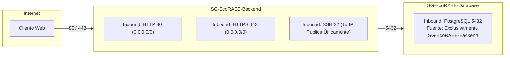

# BLUEPRINT DE ARQUITECTURA EN LA NUBE AWS — ECORAEE CLOUD
**Universidad Internacional del Ecuador (UIDE) / Arizona State University (ASU)**  
**Proyecto Integrador — Quinto Semestre**

---

## 1. Estrategia de Costo Cero ($0.00 USD / Mes) en AWS

Para garantizar que el proyecto opere dentro de la **Capa Gratuita de 12 Meses (AWS Free Tier)** de la cuenta personal sin incurrir en cobros sorpresivos, se aplican las siguientes decisiones arquitectónicas estrictas:

```mermaid
flowchart TD
    subgraph Internet["Internet Pública"]
        User["Usuarios / Clientes Web"]
    end

    subgraph AWS["AWS Cloud (Región us-east-1)"]
        IGW["Internet Gateway (Gratuito)"]
        
        subgraph VPC["Amazon VPC: 10.0.0.0/16 (Gratuito)"]
            subgraph PublicSubnets["Subredes Públicas (10.0.1.0/24 & 10.0.2.0/24)"]
                EC2["Amazon EC2 (t3.micro)<br/>750 hrs/mes Free Tier<br/>FastAPI + Nginx"]
            end
            
            subgraph PrivateSubnets["Subredes Privadas (10.0.11.0/24 & 10.0.12.0/24)"]
                RDS["Amazon RDS PostgreSQL (db.t3.micro)<br/>750 hrs/mes Free Tier<br/>20 GB gp3 + 20 GB Backup"]
            end
        end

        S3["Amazon S3: ecoraee-evidencias-storage<br/>5 GB Free Tier<br/>Evidencias Fotográficas & Actas"]
        CW["Amazon CloudWatch Logs & Metrics<br/>5 GB Ingestion Free<br/>Alarmas operativas"]
    end

    User -->|HTTPS :443 / HTTP :80| IGW
    IGW --> EC2
    EC2 -->|Puerto 5432 (Seguridad Estricta)| RDS
    EC2 -->|IAM Service Role (Sin Claves en Código)| S3
    EC2 -->|Logs & Métricas| CW
```

### Tabla de Desglose de Costos (Criterio RNF-08)

| Componente Cloud | Recurso AWS Seleccionado | Límite AWS Free Tier Mensual | Consumo Proyectado del Proyecto | Costo Mensual Estimado |
| :--- | :--- | :--- | :--- | :---: |
| **Cómputo Backend** | Amazon EC2 `t3.micro` (Linux Ubuntu 24.04 LTS) | 750 horas / mes | 720 horas (1 instancia 24/7) | **$0.00 USD** |
| **Almacenamiento EBS** | Amazon EBS General Purpose SSD (gp3) | 30 GB / mes | 20 GB (Disco raíz del EC2) | **$0.00 USD** |
| **Base de Datos** | Amazon RDS PostgreSQL `db.t3.micro` | 750 horas / mes (Single-AZ) | 720 horas (1 instancia 24/7) | **$0.00 USD** |
| **Almacenamiento RDS** | Almacenamiento SSD gp3 para Base de Datos | 20 GB de almacenamiento | 20 GB configurados | **$0.00 USD** |
| **Respaldos de BD** | Automated Backups en Amazon RDS | 20 GB de respaldo gratuito | ~5 GB en snapshots retenidos 7 días | **$0.00 USD** |
| **Almacenamiento Evidencias** | Amazon S3 Standard (`ecoraee-evidencias-storage`) | 5 GB de almacenamiento | ~50 a 100 MB (fotos de 1.5 MB) | **$0.00 USD** |
| **Peticiones S3** | S3 API Calls (PUT, GET) | 2,000 PUTs / 20,000 GETs | < 500 peticiones / mes | **$0.00 USD** |
| **Red & Enrutamiento** | Amazon VPC, Subredes e Internet Gateway | 100% Gratuito | 1 VPC, 4 subredes, 1 IGW | **$0.00 USD** |
| **Monitoreo & Logs** | Amazon CloudWatch | 10 métricas, 10 alarmas, 5 GB logs | 3 métricas, 1 alarma, < 100 MB logs | **$0.00 USD** |
| **Gestión de Identidad** | AWS Identity and Access Management (IAM) | 100% Gratuito | 5 grupos, 1 Service Role | **$0.00 USD** |
| **TOTAL MENSUAL ESTIMADO**| | | | **$0.00 USD** |

> [!TIP]
> **Decisión de Ahorro Crítica (Evitar NAT Gateway):**  
> Un AWS NAT Gateway cuesta aproximadamente **$32.40 USD al mes** solo por existir. Para mantener el costo exactamente en **$0.00 USD**, alojamos la instancia EC2 en la subred pública protegida por su propio Security Group (abriendo únicamente puertos 80/443), y colocamos la base de datos RDS en las subredes privadas. Así, la base de datos queda **100% aislada de Internet pública** y solo responde a conexiones provenientes del Security Group del EC2 en el puerto 5432, logrando máxima seguridad sin costos extras.

---

## 2. Matriz de Segmentación de Red y Grupos de Seguridad

Para dar cumplimiento a los casos de prueba de conectividad e integridad (`CP-10` y `CP-11`):



1. **`SG-EcoRAEE-Backend` (Security Group de Cómputo):**
   * *Inbound:* Puerto 80 (HTTP) y 443 (HTTPS) desde `0.0.0.0/0`.
   * *Inbound SSH:* Puerto 22 restringido a la IP del administrador o gestionado vía AWS Systems Manager (SSM) sin puertos abiertos.
   * *Outbound:* Todo el tráfico permitido para descargar paquetes y comunicarse con S3 y CloudWatch.
2. **`SG-EcoRAEE-Database` (Security Group de Base de Datos):**
   * *Inbound:* Puerto 5432 (PostgreSQL). **Origen:** ID del `SG-EcoRAEE-Backend`.
   * *Acceso Público RDS:* Deshabilitado (`PubliclyAccessible = false`). Nadie desde fuera de la VPC puede conectarse a la base de datos.

---

## 3. Seguridad de Evidencias en Amazon S3 (RN-07)

* **Bucket:** `ecoraee-evidencias-storage`
* **Bloqueo Público Total:** `BlockPublicAcls = true`, `BlockPublicPolicy = true`, `IgnorePublicAcls = true`, `RestrictPublicBuckets = true`.
* **Mecanismo de Descarga Segura:** Ninguna imagen se sirve con URL pública abierta. El backend genera **Presigned URLs** temporales con expiración de 15 minutos solo para usuarios autenticados con los roles correspondientes (`RN-07`).
