# EcoRAEE Cloud — Frontend Single Page Application (SPA)
**Universidad Internacional del Ecuador (UIDE) / Arizona State University (ASU)**  
**Proyecto Integrador — Quinto Semestre**

Aplicación web cliente Single Page Application (SPA) modular, reactiva y accesible, diseñada con arquitectura **Zero-Build** para operar tanto conectada a la API REST de **FastAPI** como alojada de forma estática en **Amazon S3 Static Website Hosting** con costo cero ($0.00 USD/mes).

---

## 1. Alcance y Arquitectura de la Solución (Parte 1: Frontend)

La interfaz gráfica implementa todas las pantallas, flujos y reglas de negocio definidas para el proyecto EcoRAEE Cloud:

```mermaid
flowchart LR
    subgraph UI["Vistas y Pantallas del Frontend SPA"]
        V1["📊 Dashboard Ejecutivo"]
        V2["🏷️ Catálogo RAEE (CRUD)"]
        V3["📦 Lotes de Recepción"]
        V4["🔬 Taller y Diagnóstico (RN-02/04)"]
        V5["🚚 Logística y Traslados (RN-03/05)"]
        V6["🔍 Trazabilidad (Timeline CP-14)"]
        V7["🎯 Destino Final (Cierre RN-08)"]
        V8["⚡ Red Edmonds-Karp (CP-08/09)"]
        V9["♿ Accesibilidad (WCAG CP-15)"]
    end

    subgraph Core["Capa de Negocio y Estado en Cliente"]
        State["appState & StorageService (localStorage Reactivo)"]
        API["ApiService (Cliente REST con JWT)"]
    end

    subgraph Backend["Capa de Servicios Cloud"]
        FastAPI["FastAPI / PostgreSQL (Amazon RDS)"]
        S3["Amazon S3 (Evidencias y Hosting)"]
    end

    UI --> State
    State <--> API
    API <--> FastAPI
    API <--> S3
```



---

## 2. Pantallas y Funcionalidades Desarrolladas

### 1. 📊 Dashboard Ejecutivo & Gobernanza Circular
* **KPIs en Tiempo Real:** Total RAEE captado en kg, inventario físico (unidades), tasa de reutilización/donación social (%), tasa de reciclaje/chatarra (%) y capacidad logística semanal.
* **Visualizaciones Gráficas:** Proporción de RAEE por categoría (computadoras, monitores, tablets, celulares, routers) y distribución activa del ciclo de vida.
* **Monitoreo de Centros:** Indicadores porcentuales de saturación en bodegas y laboratorios de campus Matriz, Granados y Taller Lab-300 con alerta ante umbrales mayores al 75%.

### 2. 🏷️ Catálogo e Inventario de Dispositivos (CRUD Completo)
* **Registrar (Create):** Modal con autogenerador de código QR institucional (`QR-UIDA-XX-###`), validación de unicidad en tiempo real (CP-02), peso numérico positivo, especificaciones de hardware y asociación a lote.
* **Consultar / Filtrar (Read):** Búsqueda instantánea multicriterio por texto (QR, número de serie, modelo, procesador) y filtros por categoría, centro y estado.
* **Visualizar Detalle:** Modal de ficha técnica completa con vista previa ampliada de la etiqueta QR institucional para impresión de etiquetas de bodega.
* **Actualizar (Update):** Edición de número de serie, peso físico medido, condición de desgaste, reubicación de centro de acopio y notas técnicas con validación.
* **Eliminar / Dar de Baja (Delete):** Modal de confirmación con campo obligatorio de motivo para auditoría institucional (CP-04).
* **Exportar Catálogo:** Descarga directa en formato CSV compatible con hojas de cálculo.

### 3. 📦 Lotes de Recepción y Donantes (CRUD)
* Registro de lotes consolidados de bajas departamentales o donaciones estudiantiles.
* Indicador visual de avance: unidades físicas pesadas versus cantidad declarada por el donante.
* Filtrado directo de dispositivos vinculados a cada lote.

### 4. 🔬 Taller Técnico, Diagnóstico y Clasificación Ambiental
* **Control de Acceso RBAC (RN-02):** La interfaz verifica el rol del usuario activo; si no posee rol de `ROL_TECNICO` o `ROL_ADMIN`, bloquea los permisos de dictamen.
* **Inspección Técnica:** Registro de prueba de encendido (POST), diagnóstico funcional y estético.
* **Clasificación Ambiental:** Asignación de jerarquía (`REUTILIZABLE`, `REPARABLE`, `RECICLABLE`, `NO_RECUPERABLE`).
* **Regla de Negocio RN-04:** Si el equipo es dictaminado como `NO_RECUPERABLE`, el sistema revoca y deshabilita automáticamente la opción de donación social, emitiendo una alerta visual explícita.
* **Despiece de Componentes:** Registro de piezas útiles extraídas (memorias RAM, SSDs, fuentes) para stock de mantenimiento.

### 5. 🚚 Logística, Despacho y Traslados entre Nodos
* Programación de manifiestos de traslado entre centros con validación de que origen y destino sean distintos (RN-03).
* Multiselección interactiva de dispositivos con cálculo de peso total en tiempo real.
* **Regla de Negocio RN-05:** Comprobación automática de no saturación de la capacidad del centro de destino.
* Confirmación de recepción física en destino con sellado de fecha y reubicación automática de inventario.

### 6. 🔍 Trazabilidad Ininterrumpida Extremo a Extremo
* Rastreo rápido por código QR o número de serie con accesos directos a casos de prueba oficiales.
* **Línea de Vida Inmutable (Timeline Vertical):** Cada evento muestra secuencia ordinal, estado, fecha y hora, responsable y observaciones.
* **Transición de Estado Atómica (CP-03):** Permite avanzar el ciclo de vida validando roles autorizados.
* **Certificado Imprimible:** Generación de acta oficial con membrete UIDE para impresión o guardado como PDF (`@media print`).

### 7. 🎯 Destino Final y Certificación de Cierre (RN-08)
* Formalización de salidas definitivas por canal de Donación Social Educativa o Reciclaje Calificado MAATE.
* Validación de entidad receptora, fecha oficial de confirmación y número de certificado para cierre formal en estado terminal `TRAZABILIDAD_CERRADA`.

### 8. ⚡ Optimización de Flujo Logístico (Edmonds-Karp / CP-08 / CP-09)
* Conexión con el endpoint backend `/api/v1/network/optimize-flow` o motor de optimización local.
* Visualizador interactivo SVG de la red de transporte del campus UIDA.
* Conmutador entre **Escenario Base Normal** (3,100 kg/semana) y **Escenario 2: Contingencia Vial Sur** (2,000 kg/semana).
* Resaltado dinámico en rojo de las aristas saturadas que conforman el **Corte Mínimo $C(S,T)$** (cuellos de botella).

### 9. ♿ Usabilidad, Inclusión y Matriz de Casos de Prueba (CP-15)
* **Modo de Alto Contraste:** Cumplimiento con estándares WCAG 2.1 AAA para ambientes de bodega.
* **Tipografía Ampliada:** Escalado del tamaño de fuente al 120% para lectura rápida.
* **Matriz de Casos de Prueba (CP-01 a CP-15):** Botones interactivos que permiten a docentes y evaluadores disparar y verificar el comportamiento de cada prueba con un solo clic.

---

## 3. Formularios y Validaciones Implementadas

| Formulario | Validaciones de Entrada | Regla de Negocio / Caso de Prueba |
| :--- | :--- | :--- |
| **Alta de Dispositivo** | QR con prefijo `QR-UIDA-`, unicidad estricta, peso $> 0$ kg, selección obligatoria de modelo y categoría. | **CP-02 / RN-01** (Identificador único e ingreso inmutable) |
| **Edición de Dispositivo** | Bloqueo de modificación del código QR (inmutable), peso numérico positivo, condición válida. | **CP-04 / RN-01** (Preservación de identidad de activo) |
| **Baja de Dispositivo** | Exclusivo para rol Administrador; justificación textual obligatoria para auditoría. | **CP-04** (Auditoría de eliminación con rollback) |
| **Evaluación Técnica** | Bloqueo si el rol no es técnico; diagnóstico funcional y estético requeridos. | **RN-02** (Exclusividad de evaluación técnica) |
| **Donación a Beneficiario** | Deshabilitación y desmarque forzoso si la clasificación es `NO_RECUPERABLE`. | **RN-04** (Prohibición de donación de chatarra) |
| **Programación de Flete** | Origen $\neq$ Destino, al menos un equipo seleccionado, peso $\le$ capacidad disponible. | **RN-03 / RN-05** (Integridad logística y capacidad de red) |
| **Destino Final** | Entidad receptora, número de acta/certificado y fecha de confirmación requeridos. | **RN-08** (Cierre formal de ciclo de vida) |

---

## 4. Instrucciones de Ejecución

### Opción A: Ejecución Local Inmediata (Zero-Build en Navegador)
Simplemente haz doble clic sobre el archivo `frontend/index.html` o ábrelo en cualquier navegador moderno (Chrome, Edge, Firefox, Safari). La aplicación funciona al 100% en modo reactivo autónomo.

### Opción B: Ejecución Conectada con Backend FastAPI
1. Iniciar el backend en la terminal:
   ```bash
   uvicorn backend.app.main:app --reload --port 8000
   ```
2. Abrir `frontend/index.html`. La SPA detectará automáticamente la API en `http://localhost:8000` y mostrará la insignia verde **"FastAPI Conectada"**.

### Opción C: Despliegue en Amazon S3 Static Website Hosting (`RF-CL-01`)
1. Crear un bucket en Amazon S3 (ej. `ecoraee-frontend-storage`).
2. Habilitar **Static website hosting** con documento de índice `index.html`.
3. Cargar los archivos `index.html`, `styles.css` y `app.js`.
4. El sistema estará disponible globalmente con costo de cómputo de $0.00 USD/mes.
