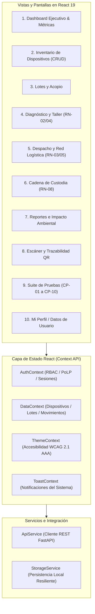

# EcoRAEE Cloud — Frontend en React (SPA)
**Universidad Internacional del Ecuador (UIDE) / Arizona State University (ASU)**  
**Proyecto Integrador — Quinto Semestre**

Plataforma web cliente Single Page Application (SPA) modular, reactiva y accesible, desarrollada en **React 19** con **Vite** para la gestión, pesaje, diagnóstico técnico y trazabilidad integral de Residuos de Aparatos Eléctricos y Electrónicos (RAEE).

---

## 1. Alcance y Arquitectura de la Solución (Parte 1: Frontend)

La aplicación implementa todas las pantallas, componentes, flujos y reglas de negocio del sistema EcoRAEE Cloud, aplicando el **Principio de Mínimo Privilegio (PoLP)** y Control de Acceso Basado en Roles (RBAC):



---

## 2. Tecnologías y Estructura del Proyecto

### Stack Tecnológico
- **React 19** (`react`, `react-dom`) con Hooks funcionales (`useState`, `useEffect`, `useContext`, `useCallback`).
- **Vite 8** para empaquetado de alta velocidad y compilación modular optimizada.
- **CSS3 Puro** con variables semánticas, diseño adaptativo (Responsive Grid / Flexbox) y soporte estricto para Alto Contraste (WCAG 2.1 AAA).
- **0 Emojis**: Iconografía basada íntegramente en SVG vectorial e insignias textuales formales (`[EXITO]`, `[ERROR]`, `[AVISO]`, `[INFO]`).
- **Persistencia Híbrida**: Integración con endpoints REST de FastAPI con fallback automático a `StorageService` en `localStorage`.

### Árbol de Archivos
```text
frontend/
├── dist/                          # Compilación de producción (Vite build)
├── node_modules/                  # Dependencias de React y Vite
├── public/                        # Recursos públicos
├── src/
│   ├── components/
│   │   ├── common/                # Componentes reutilizables
│   │   ├── layout/
│   │   │   ├── Header.jsx         # Encabezado institucional, sesión y accesibilidad
│   │   │   └── Sidebar.jsx        # Menú lateral con iconos SVG por sección
│   │   └── modals/
│   │       ├── DeleteDeviceModal.jsx     # Confirmación de baja con motivo y PoLP
│   │       ├── DeviceDetailModal.jsx     # Ficha técnica y timeline cronológico
│   │       ├── DeviceFormModal.jsx       # Formulario registrar/editar con validaciones
│   │       ├── LoginModal.jsx            # Autenticación con credenciales institucionales
│   │       ├── PrintCertificateModal.jsx # Certificado institucional imprimible
│   │       └── QrModal.jsx               # Visualizador de código QR y barras CODE128
│   ├── context/
│   │   ├── AuthContext.jsx        # Gestión de usuarios, perfiles y mínimo privilegio
│   │   ├── DataContext.jsx        # CRUD de activos, pesajes, lotes y traslados
│   │   ├── ThemeContext.jsx       # Alternancia de alto contraste y fuente grande
│   │   └── ToastContext.jsx       # Notificaciones flotantes no intrusivas
│   ├── data/
│   │   └── seedData.js            # Datos iniciales institucionales (UIDE / ASU)
│   ├── services/
│   │   └── apiService.js          # Cliente REST y fallback resiliente en almacenamiento local
│   ├── styles/
│   │   └── styles.css             # Estilos globales, variables de color y accesibilidad
│   ├── views/
│   │   ├── BatchesView.jsx        # Gestión y consolidación de lotes
│   │   ├── CustodyView.jsx        # Cierre de cadena de custodia y actas MAAE
│   │   ├── DashboardView.jsx      # Panel de métricas, gobernanza y KPIs
│   │   ├── DiagnosisView.jsx      # Taller de evaluación técnica (Lab-302)
│   │   ├── InventoryView.jsx      # Inventario general con filtros y exportación CSV
│   │   ├── LogisticsView.jsx      # Despacho y diagrama de red Edmonds-Karp
│   │   ├── ProfileView.jsx        # Página de usuario: mis datos, contraseña y PoLP
│   │   ├── QrScannerView.jsx      # Escáner y buscador de pasaporte digital
│   │   ├── ReportsView.jsx        # Reportes de impacto ambiental y CO2 evitado
│   │   └── TestsView.jsx          # Suite de pruebas y matriz de reglas de negocio
│   ├── App.jsx                    # Ensamblador principal de vistas y modales
│   └── main.jsx                   # Punto de entrada y montaje en el DOM
├── vanilla/                       # Respaldo de la implementación en HTML/JS puro
├── index.html                     # Entrada HTML para Vite
├── package.json                   # Manifiesto npm con scripts dev, build y preview
├── vite.config.js                 # Configuración del plugin de React en Vite
└── README.md                      # Documentación técnica del módulo
```

---

## 3. Instrucciones de Ejecución

### Requisitos Previos
- **Node.js** v18 o superior (validado en Node v24.19).
- **npm** v10 o superior (validado en npm v11.17).

### Comandos de Ejecución
1. **Instalar dependencias:**
   ```bash
   cd 05_PROTOTIPO_SOFTWARE_ECORAEE/frontend
   npm install
   ```

2. **Iniciar servidor de desarrollo con Hot Module Replacement (HMR):**
   ```bash
   npm run dev
   ```
   *La consola indicará la dirección local (por defecto: `http://localhost:5173`).*

3. **Compilar para producción:**
   ```bash
   npm run build
   ```
   *Genera los archivos empaquetados y optimizados en la carpeta `dist/`.*

4. **Previsualizar la compilación de producción:**
   ```bash
   npm run preview
   ```

---

## 4. Matriz de Mínimo Privilegio (PoLP) y Roles Institucionales

| Rol Institucional | Usuario | Permisos Otorgados | Restricciones Estrictas de Seguridad |
| :--- | :--- | :--- | :--- |
| **Operador de Acopio** | `carlos.operador` | Recepción física, pesaje en báscula (`RN-01`), registro de equipos (`CP-02`), impresión de etiquetas QR. | Bloqueado para emitir diagnósticos técnicos (`RN-02`), donaciones (`RN-04`), bajas físicas (`CP-04`) y sellado de actas (`RN-08`). |
| **Técnico de Diagnóstico** | `maria.tecnico` | Diagnóstico de hardware en taller Lab-302 (`RN-02`), clasificación A/B/C/D, verificación de viabilidad de donación. | Bloqueada para dar de baja activos (`CP-04`) o alterar manifiestos ambientales de transporte. |
| **Coordinador Logístico** | `diego.logistica` | Despacho de vehículos, cálculo de masa máxima (`RN-03`), monitoreo del modelo Edmonds-Karp (`RN-05`). | Bloqueado para alterar dictámenes técnicos o ejecutar bajas del inventario. |
| **Auditor de Calidad** | `ana.auditora` | Inspección de trazabilidad integral, verificación de manifiestos MAAE y sellado de actas de custodia (`RN-08`). | Modo estrictamente supervisor; no altera clasificaciones técnicas operativas. |
| **Administrador General** | `admin_sys` | Control global de plataforma, gestión de cuentas y autorización de bajas de inventario (`CP-04`). | Responsabilidad y auditoría registrada en cada operación destructiva. |

---

## 5. Reglas de Negocio Implementadas y Validadas

- **RN-01 (Pesaje Obligatorio):** Todo dispositivo debe registrar su masa real mayor a 0 kg pesada en báscula.
- **RN-02 (Dictamen Técnico Exclusivo):** Solo personal con rol técnico o administrador puede emitir evaluaciones de laboratorio.
- **RN-03 (Capacidad Vehicular):** Las transferencias logísticas impiden exceder la capacidad nominal de carga del camión asignado.
- **RN-04 (Restricción de Donación):** Prohibición estricta de donar residuos dictaminados como chatarra o repuestos (Grados C y D).
- **RN-05 (Flujo Máximo Edmonds-Karp):** Visualización interactiva de cuellos de botella en la red entre campus y gestor.
- **RN-06 (Unicidad Global de QR):** Validación en tiempo real para evitar códigos QR o seriales repetidos.
- **RN-07 (Control de Acceso PoLP):** Interfaz adaptativa que deshabilita controles y bloquea acciones no autorizadas con alertas formales.
- **RN-08 (Sellado de Custodia):** Cierre del ciclo de vida legal con número de manifiesto ambiental MAAE y acta firmada.
